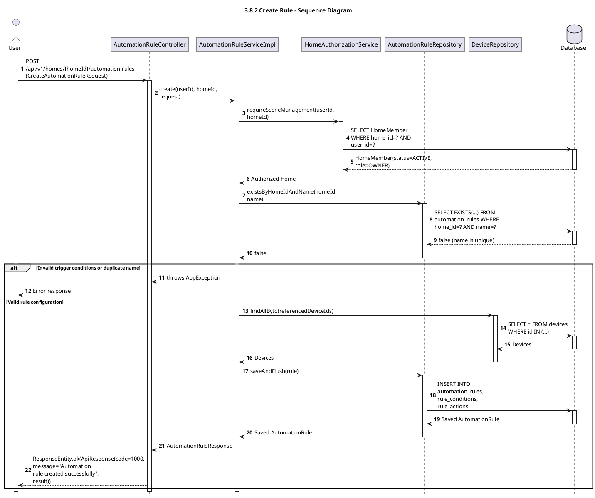
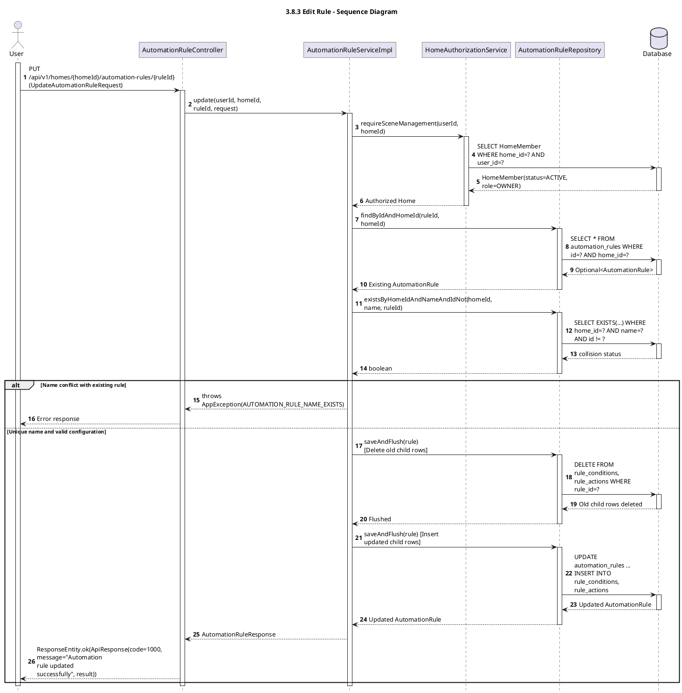
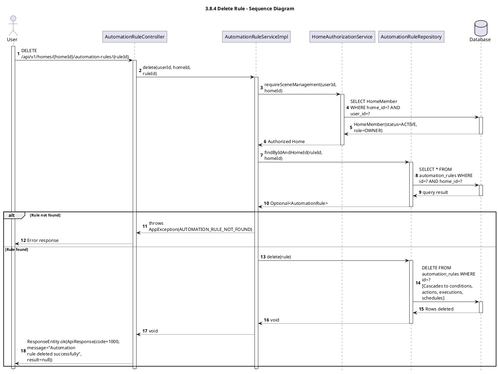
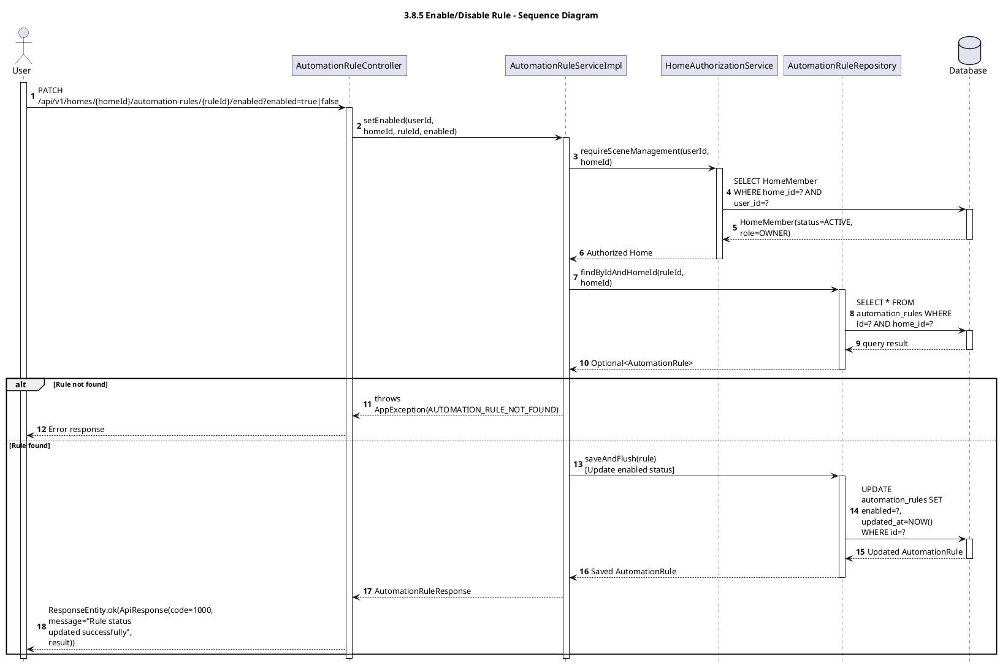
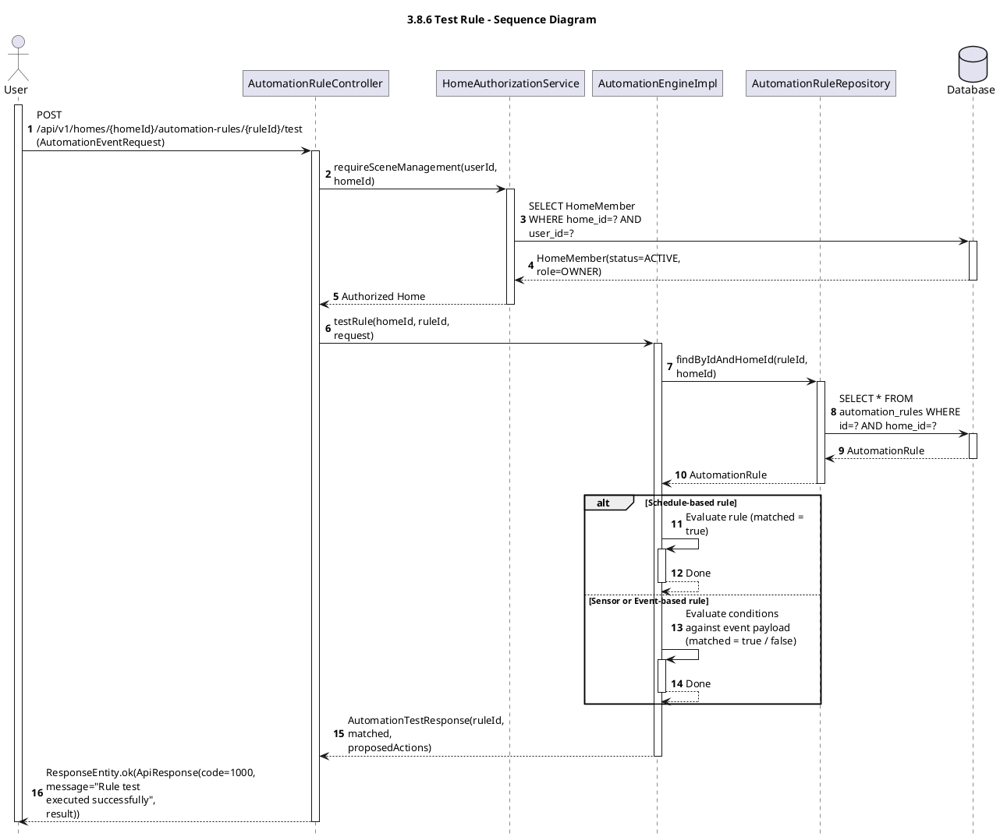
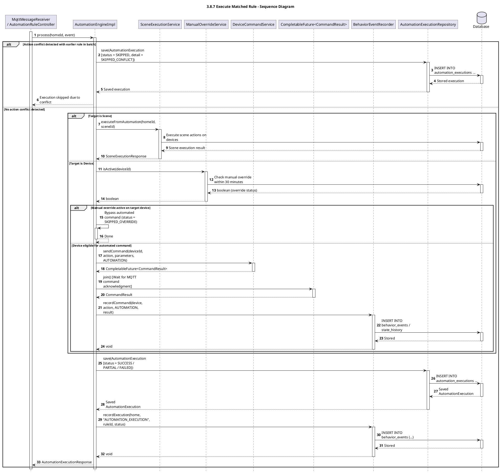
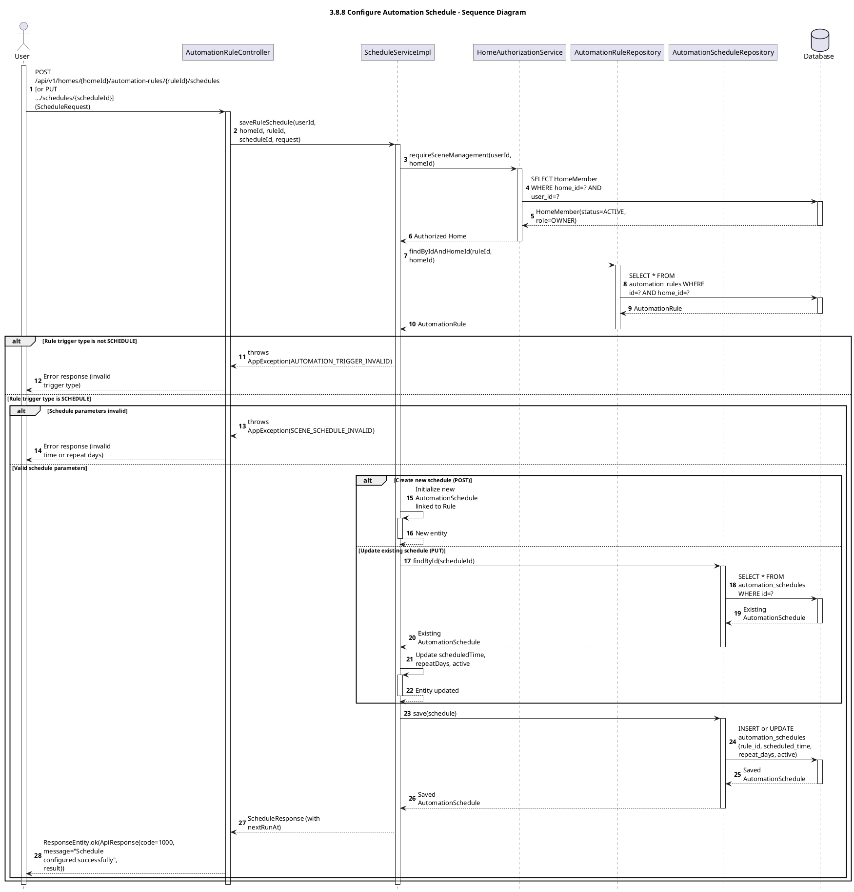

# 3.8 Automation Management and Execution

> Technical specification and architectural modeling for **3.8 Automation Management and Execution** in the HESTA Smart Home system.
>
> All models and diagrams strictly correspond to the production codebase:
> - Controller: [`AutomationRuleController.java`](file:///d:/CapstoneProject/backend_hesta/src/main/java/com/hesta/backend/controller/AutomationRuleController.java)
> - Services: [`AutomationRuleServiceImpl.java`](file:///d:/CapstoneProject/backend_hesta/src/main/java/com/hesta/backend/service/impl/AutomationRuleServiceImpl.java), [`AutomationEngineImpl.java`](file:///d:/CapstoneProject/backend_hesta/src/main/java/com/hesta/backend/service/impl/AutomationEngineImpl.java)
> - Entities & Enums: [`AutomationRule.java`](file:///d:/CapstoneProject/backend_hesta/src/main/java/com/hesta/backend/entity/AutomationRule.java), [`RuleCondition.java`](file:///d:/CapstoneProject/backend_hesta/src/main/java/com/hesta/backend/entity/RuleCondition.java), [`RuleAction.java`](file:///d:/CapstoneProject/backend_hesta/src/main/java/com/hesta/backend/entity/RuleAction.java), [`AutomationExecution.java`](file:///d:/CapstoneProject/backend_hesta/src/main/java/com/hesta/backend/entity/AutomationExecution.java), [`TriggerType.java`](file:///d:/CapstoneProject/backend_hesta/src/main/java/com/hesta/backend/enums/TriggerType.java), [`ConditionOperator.java`](file:///d:/CapstoneProject/backend_hesta/src/main/java/com/hesta/backend/enums/ConditionOperator.java), [`LogicalOperator.java`](file:///d:/CapstoneProject/backend_hesta/src/main/java/com/hesta/backend/enums/LogicalOperator.java), [`ExecutionStatus.java`](file:///d:/CapstoneProject/backend_hesta/src/main/java/com/hesta/backend/enums/ExecutionStatus.java)
> - Repositories: [`AutomationRuleRepository.java`](file:///d:/CapstoneProject/backend_hesta/src/main/java/com/hesta/backend/repository/AutomationRuleRepository.java), [`AutomationExecutionRepository.java`](file:///d:/CapstoneProject/backend_hesta/src/main/java/com/hesta/backend/repository/AutomationExecutionRepository.java), [`DeviceRepository.java`](file:///d:/CapstoneProject/backend_hesta/src/main/java/com/hesta/backend/repository/DeviceRepository.java), [`SceneRepository.java`](file:///d:/CapstoneProject/backend_hesta/src/main/java/com/hesta/backend/repository/SceneRepository.java)

---

## Module Overview

The **Automation Management and Execution** subsystem provides intelligent automation workflows for the smart home:
1. **Rule Lifecycle Management**: Enables Home Owners (`OWNER` role with `ACTIVE` membership) to create, update, enable/disable, and delete automation rules ([`AutomationRule`](file:///d:/CapstoneProject/backend_hesta/src/main/java/com/hesta/backend/entity/AutomationRule.java)). Each rule is composed of an ordered list of criteria ([`RuleCondition`](file:///d:/CapstoneProject/backend_hesta/src/main/java/com/hesta/backend/entity/RuleCondition.java)) and sequential target operations ([`RuleAction`](file:///d:/CapstoneProject/backend_hesta/src/main/java/com/hesta/backend/entity/RuleAction.java)).
2. **Trigger Types**:
   - `SENSOR`: Triggered by physical sensor telemetry readings (temperature, humidity, motion, smoke, etc.).
   - `EVENT`: Triggered by device state transition events (door opened, light switched on/off, etc.).
   - `SCHEDULE`: Triggered by time-based schedules recurring on specified days.
3. **Condition Evaluation Engine**: Evaluates criteria strictly in zero-indexed `order`. Supported comparison operators include `EQ`, `NE`, `GT`, `GTE`, `LT`, and `LTE`, combined across multi-condition chains using `AND` / `OR` logical operators via left-fold evaluation.
4. **Safety and Conflict Protection**:
   - **Conflict Detection (`conflicts`)**: Prevents conflicting commands across simultaneously triggered rules within the same processing batch (e.g., `TURN_ON` vs `TURN_OFF`, `TOGGLE`, `SET_STATE`). Conflicting rules are automatically marked as `SKIPPED` with a `SKIPPED_CONFLICT` detail.
   - **Manual Override Guard ([`ManualOverrideService`](file:///d:/CapstoneProject/backend_hesta/src/main/java/com/hesta/backend/service/ManualOverrideService.java))**: If a resident manually controlled a device within the preceding 30 minutes, automated commands targeting that device are bypassed with a `SKIPPED_OVERRIDE` status.
5. **Dry-Run Rule Testing (`testRule`)**: Allows owners to test rule criteria against simulated event payloads. The engine returns whether the rule matched (`matched`) alongside a preview of proposed actions (`proposedActions`) without dispatching hardware commands or writing execution logs.
6. **Execution Pipeline & Telemetry**: Executes matching actions sequentially (dispatching device commands through [`DeviceCommandService`](file:///d:/CapstoneProject/backend_hesta/src/main/java/com/hesta/backend/service/DeviceCommandService.java) or invoking scenes through [`SceneExecutionService`](file:///d:/CapstoneProject/backend_hesta/src/main/java/com/hesta/backend/service/SceneExecutionService.java)), aggregates overall outcome status (`SUCCESS`, `PARTIAL`, `FAILED`, `SKIPPED`), persists an audit record in [`AutomationExecution`](file:///d:/CapstoneProject/backend_hesta/src/main/java/com/hesta/backend/entity/AutomationExecution.java), and records telemetry in [`BehaviorEventRecorder`](file:///d:/CapstoneProject/backend_hesta/src/main/java/com/hesta/backend/service/BehaviorEventRecorder.java).

---

## 3.8.1 Class diagram

The class diagram below depicts the object-oriented architecture of the Automation subsystem structured into 4 cohesive architectural layers:
- **Controller & Service Layer**: REST controllers, business service interfaces, service implementations, and collaborator ports.
- **Persistence Layer**: Spring Data JPA repositories extending generic `JpaRepository`.
- **Domain Model Layer**: JPA entities with cascade mappings, orphan removal configurations, and domain enumerations.
- **DTO Contracts Layer**: Request and response data transfer objects.

```plantuml
@startuml C_3_8_Automation
title 3.8.1 Automation Management and Execution - Class Diagram
skinparam backgroundColor white
skinparam shadowing false
skinparam roundcorner 0
skinparam defaultFontName Arial
skinparam defaultFontSize 12
skinparam ArrowColor #374151
hide circle
skinparam classAttributeIconSize 0
skinparam nodesep 30
skinparam ranksep 40

package "Controller & Service Layer" as ServiceLayer {
  class AutomationRuleController {
    - ruleService : AutomationRuleService
    - automationEngine : AutomationEngine
    - homeAuthorizationService : HomeAuthorizationService
    - scheduleService : ScheduleService
    + create(user, homeId, request) : ResponseEntity<ApiResponse<AutomationRuleResponse>>
    + getAll(user, homeId) : ResponseEntity<ApiResponse<List<AutomationRuleResponse>>>
    + get(user, homeId, ruleId) : ResponseEntity<ApiResponse<AutomationRuleResponse>>
    + update(user, homeId, ruleId, request) : ResponseEntity<ApiResponse<AutomationRuleResponse>>
    + setEnabled(user, homeId, ruleId, enabled) : ResponseEntity<ApiResponse<AutomationRuleResponse>>
    + delete(user, homeId, ruleId) : ResponseEntity<ApiResponse<Void>>
    + executions(user, homeId, ruleId) : ResponseEntity<ApiResponse<List<AutomationExecutionResponse>>>
    + processEvent(user, homeId, request) : ResponseEntity<ApiResponse<AutomationEngineResponse>>
    + testRule(user, homeId, ruleId, request) : ResponseEntity<ApiResponse<AutomationTestResponse>>
    + schedules(user, homeId, ruleId) : ResponseEntity<ApiResponse<List<ScheduleResponse>>>
    + createSchedule(user, homeId, ruleId, request) : ResponseEntity<ApiResponse<ScheduleResponse>>
    + updateSchedule(user, homeId, ruleId, scheduleId, request) : ResponseEntity<ApiResponse<ScheduleResponse>>
    + deleteSchedule(user, homeId, ruleId, scheduleId) : ResponseEntity<ApiResponse<Void>>
  }

  interface AutomationRuleService {
    + create(userId, homeId, request) : AutomationRuleResponse
    + getAll(userId, homeId) : List<AutomationRuleResponse>
    + get(userId, homeId, ruleId) : AutomationRuleResponse
    + update(userId, homeId, ruleId, request) : AutomationRuleResponse
    + setEnabled(userId, homeId, ruleId, enabled) : AutomationRuleResponse
    + delete(userId, homeId, ruleId) : void
    + getExecutions(userId, homeId, ruleId) : List<AutomationExecutionResponse>
  }

  class AutomationRuleServiceImpl {
    - homeAuthorizationService : HomeAuthorizationService
    - ruleRepository : AutomationRuleRepository
    - executionRepository : AutomationExecutionRepository
    - deviceRepository : DeviceRepository
    - sceneRepository : SceneRepository
    - objectMapper : ObjectMapper
    + create(userId, homeId, request) : AutomationRuleResponse
    + getAll(userId, homeId) : List<AutomationRuleResponse>
    + get(userId, homeId, ruleId) : AutomationRuleResponse
    + update(userId, homeId, ruleId, request) : AutomationRuleResponse
    + setEnabled(userId, homeId, ruleId, enabled) : AutomationRuleResponse
    + delete(userId, homeId, ruleId) : void
    + getExecutions(userId, homeId, ruleId) : List<AutomationExecutionResponse>
    - replaceChildren(rule, conditions, actions, home) : void
    - buildCondition(rule, request, devices, home) : RuleCondition
    - buildAction(rule, request, devices, home) : RuleAction
    - validateName(name, homeId, excludedId) : void
    - validateOrders(orders, errorCode) : void
    - loadDevices(conditions, actions) : Map<UUID, Device>
  }

  interface AutomationEngine {
    + process(homeId, event) : AutomationEngineResponse
    + testRule(homeId, ruleId, event) : AutomationTestResponse
    + executeScheduled(homeId, ruleId) : AutomationExecutionResponse
  }

  class AutomationEngineImpl {
    - ruleRepository : AutomationRuleRepository
    - executionRepository : AutomationExecutionRepository
    - deviceRepository : DeviceRepository
    - deviceCommandService : DeviceCommandService
    - objectMapper : ObjectMapper
    - behaviorEventRecorder : BehaviorEventRecorder
    - manualOverrideService : ManualOverrideService
    - sceneExecutionService : SceneExecutionService
    + process(homeId, event) : AutomationEngineResponse
    + testRule(homeId, ruleId, event) : AutomationTestResponse
    + executeScheduled(homeId, ruleId) : AutomationExecutionResponse
    - matches(rule, event) : boolean
    - evaluate(condition, event) : boolean
    - conflicts(rule, reserved) : boolean
    - conflicts(left, right) : boolean
    - targetActions(action) : List<RuleAction>
    - execute(rule, event) : AutomationExecutionResponse
    - validateSourceDevice(homeId, event) : void
  }

  class HomeAuthorizationService {
    + requireAccess(userId, homeId) : Home
    + requireSceneManagement(userId, homeId) : Home
  }

  interface DeviceCommandService {
    + sendCommand(deviceId, action, parameters, source) : CompletableFuture<CommandResult>
  }

  interface SceneExecutionService {
    + executeFromAutomation(homeId, sceneId) : SceneExecutionResponse
  }

  interface ScheduleService {
    + ruleSchedules(userId, homeId, ruleId) : List<ScheduleResponse>
    + saveRuleSchedule(userId, homeId, ruleId, scheduleId, request) : ScheduleResponse
    + deleteRuleSchedule(userId, homeId, ruleId, scheduleId) : void
  }

  class ScheduleServiceImpl {
    - authorization : HomeAuthorizationService
    - rules : AutomationRuleRepository
    - ruleSchedules : AutomationScheduleRepository
    + ruleSchedules(userId, homeId, ruleId) : List<ScheduleResponse>
    + saveRuleSchedule(userId, homeId, ruleId, scheduleId, request) : ScheduleResponse
    + deleteRuleSchedule(userId, homeId, ruleId, scheduleId) : void
  }

  interface ManualOverrideService {
    + isActive(deviceId) : boolean
  }

  interface BehaviorEventRecorder {
    + recordCommand(device, action, source, result) : void
    + recordSensor(device, event) : void
    + recordExecution(home, userId, eventType, targetId, status) : void
  }
}

package "Persistence Layer" as PersistenceLayer {
  interface "JpaRepository<T, ID>" as JpaRepository <<Spring Data>> {
    + save(entity) : T
    + saveAndFlush(entity) : T
    + findById(id) : Optional<T>
    + findAllById(ids) : List<T>
    + delete(entity) : void
  }

  interface AutomationRuleRepository {
    + findAllByHomeIdOrderByNameAsc(homeId) : List<AutomationRule>
    + findByIdAndHomeId(id, homeId) : Optional<AutomationRule>
    + findAllByHomeIdAndEnabledTrueAndTriggerTypeIn(homeId, triggerTypes) : List<AutomationRule>
    + fetchActionsByIdIn(ids) : List<AutomationRule>
    + existsByHomeIdAndName(homeId, name) : boolean
    + existsByHomeIdAndNameAndIdNot(homeId, name, id) : boolean
    + existsActionForScene(sceneId) : boolean
  }

  interface AutomationExecutionRepository {
    + findTop100ByRuleIdOrderByMatchedAtDesc(ruleId) : List<AutomationExecution>
  }

  interface DeviceRepository {
    + findById(id) : Optional<Device>
    + findAllById(ids) : List<Device>
  }

  interface SceneRepository {
    + findByIdAndHomeId(id, homeId) : Optional<Scene>
  }

  interface AutomationScheduleRepository {
    + findAllByRuleIdOrderByScheduledTimeAsc(ruleId) : List<AutomationSchedule>
    + findAllByActiveTrueAndScheduledTime(scheduledTime) : List<AutomationSchedule>
  }
}

package "Domain Model Layer" as DomainLayer {
  class AutomationRule {
    - id : UUID
    - home : Home
    - name : String
    - description : String
    - triggerType : TriggerType
    - enabled : boolean
    - conditions : List<RuleCondition>
    - actions : List<RuleAction>
    - createdAt : OffsetDateTime
    - updatedAt : OffsetDateTime
  }

  class RuleCondition {
    - id : UUID
    - rule : AutomationRule
    - device : Device
    - attribute : String
    - operator : ConditionOperator
    - expectedValue : JsonNode
    - logicalOperator : LogicalOperator
    - order : int
  }

  class RuleAction {
    - id : UUID
    - rule : AutomationRule
    - device : Device
    - scene : Scene
    - action : String
    - parameters : Map<String, Object>
    - order : int
  }

  class AutomationExecution {
    - id : UUID
    - rule : AutomationRule
    - triggerSource : String
    - matchedAt : OffsetDateTime
    - startedAt : OffsetDateTime
    - completedAt : OffsetDateTime
    - status : ExecutionStatus
    - test : boolean
    - resultDetail : JsonNode
  }

  class AutomationSchedule {
    - id : UUID
    - rule : AutomationRule
    - scheduledTime : LocalTime
    - repeatDays : Short[]
    - active : boolean
    - createdAt : OffsetDateTime
  }

  class Home {
    - id : UUID
    - name : String
  }

  class Device {
    - id : UUID
    - name : String
    - deviceType : String
    - currentState : Map<String, Object>
    - capabilities : DeviceCapabilities
    + getHome() : Home
    + supportsAction(action) : boolean
  }

  class Scene {
    - id : UUID
    - name : String
    - enabled : boolean
    - actions : List<SceneAction>
  }

  enum TriggerType <<enumeration>> {
    SENSOR
    EVENT
    SCHEDULE
  }

  enum ConditionOperator <<enumeration>> {
    EQ
    NE
    GT
    GTE
    LT
    LTE
  }

  enum LogicalOperator <<enumeration>> {
    AND
    OR
  }

  enum ExecutionStatus <<enumeration>> {
    PENDING
    SUCCESS
    PARTIAL
    FAILED
    SKIPPED
  }
}

package "DTO Contracts Layer" as DTOLayer {
  class CreateAutomationRuleRequest {
    - name : String
    - description : String
    - triggerType : String
    - enabled : Boolean
    - conditions : List<RuleConditionRequest>
    - actions : List<RuleActionRequest>
  }

  class UpdateAutomationRuleRequest {
    - name : String
    - description : String
    - triggerType : String
    - enabled : Boolean
    - conditions : List<RuleConditionRequest>
    - actions : List<RuleActionRequest>
  }

  class RuleConditionRequest {
    - deviceId : UUID
    - attribute : String
    - operator : String
    - expectedValue : Object
    - logicalOperator : String
    - order : Integer
  }

  class RuleActionRequest {
    - deviceId : UUID
    - sceneId : UUID
    - action : String
    - parameters : Map<String, Object>
    - order : Integer
  }

  class AutomationEventRequest {
    - sourceDeviceId : UUID
    - eventType : String
    - data : Map<String, Object>
    - occurredAt : OffsetDateTime
    - test : boolean
  }

  class AutomationRuleResponse {
    - id : UUID
    - homeId : UUID
    - name : String
    - description : String
    - triggerType : String
    - enabled : boolean
    - conditions : List<RuleConditionResponse>
    - actions : List<RuleActionResponse>
    - createdAt : OffsetDateTime
    - updatedAt : OffsetDateTime
  }

  class RuleConditionResponse {
    - id : UUID
    - deviceId : UUID
    - deviceName : String
    - attribute : String
    - operator : String
    - expectedValue : Object
    - logicalOperator : String
    - order : int
  }

  class RuleActionResponse {
    - id : UUID
    - deviceId : UUID
    - deviceName : String
    - sceneId : UUID
    - sceneName : String
    - action : String
    - parameters : Map<String, Object>
    - order : int
  }

  class AutomationTestResponse {
    - ruleId : UUID
    - matched : boolean
    - proposedActions : List<RuleActionResponse>
  }

  class AutomationExecutionResponse {
    - id : UUID
    - ruleId : UUID
    - ruleName : String
    - triggerSource : String
    - status : String
    - test : boolean
    - matchedAt : OffsetDateTime
    - startedAt : OffsetDateTime
    - completedAt : OffsetDateTime
    - resultDetail : JsonNode
  }

  class AutomationEngineResponse {
    - evaluatedRules : int
    - matchedRules : int
    - executions : List<AutomationExecutionResponse>
  }

  class ScheduleRequest {
    - scheduledTime : LocalTime
    - repeatDays : List<Short>
    - active : Boolean
  }

  class ScheduleResponse {
    - id : UUID
    - scheduledTime : LocalTime
    - repeatDays : List<Short>
    - active : boolean
    - nextRunAt : OffsetDateTime
  }
}

' Realizations
AutomationRuleServiceImpl ..|> AutomationRuleService : implements
AutomationEngineImpl ..|> AutomationEngine : implements
ScheduleServiceImpl ..|> ScheduleService : implements

' Repositories extend JpaRepository
AutomationRuleRepository --|> JpaRepository : extends
AutomationExecutionRepository --|> JpaRepository : extends
AutomationScheduleRepository --|> JpaRepository : extends
DeviceRepository --|> JpaRepository : extends
SceneRepository --|> JpaRepository : extends

' Injections / Dependencies in Controller & Services
AutomationRuleController --> AutomationRuleService : ruleService
AutomationRuleController --> AutomationEngine : automationEngine
AutomationRuleController --> HomeAuthorizationService : homeAuthorizationService
AutomationRuleController --> ScheduleService : scheduleService

AutomationRuleServiceImpl --> HomeAuthorizationService : homeAuthorizationService
AutomationRuleServiceImpl --> AutomationRuleRepository : ruleRepository
AutomationRuleServiceImpl --> AutomationExecutionRepository : executionRepository
AutomationRuleServiceImpl --> DeviceRepository : deviceRepository
AutomationRuleServiceImpl --> SceneRepository : sceneRepository

ScheduleServiceImpl --> HomeAuthorizationService : authorization
ScheduleServiceImpl --> AutomationRuleRepository : rules
ScheduleServiceImpl --> AutomationScheduleRepository : ruleSchedules

AutomationEngineImpl --> AutomationRuleRepository : ruleRepository
AutomationEngineImpl --> AutomationExecutionRepository : executionRepository
AutomationEngineImpl --> DeviceRepository : deviceRepository
AutomationEngineImpl --> DeviceCommandService : deviceCommandService
AutomationEngineImpl --> BehaviorEventRecorder : behaviorEventRecorder
AutomationEngineImpl --> ManualOverrideService : manualOverrideService
AutomationEngineImpl --> SceneExecutionService : sceneExecutionService

' Domain Relationships
AutomationRule "0..*" --> "1" Home : home
AutomationRule "1" *-- "0..*" RuleCondition : conditions (cascade ALL, orphanRemoval)
AutomationRule "1" *-- "1..*" RuleAction : actions (cascade ALL, orphanRemoval)
AutomationRule "1" -- "0..*" AutomationSchedule : schedules
RuleCondition "0..*" --> "0..1" Device : device
RuleAction "0..*" --> "0..1" Device : device
RuleAction "0..*" --> "0..1" Scene : scene
AutomationExecution "0..*" --> "1" AutomationRule : rule
AutomationSchedule --> AutomationRule : rule
AutomationRule --> TriggerType : triggerType
RuleCondition --> ConditionOperator : operator
RuleCondition --> LogicalOperator : logicalOperator
AutomationExecution --> ExecutionStatus : status

' DTO Aggregations
CreateAutomationRuleRequest "1" o-- "0..*" RuleConditionRequest : conditions
CreateAutomationRuleRequest "1" o-- "1..*" RuleActionRequest : actions
UpdateAutomationRuleRequest "1" o-- "0..*" RuleConditionRequest : conditions
UpdateAutomationRuleRequest "1" o-- "1..*" RuleActionRequest : actions
AutomationRuleResponse "1" o-- "0..*" RuleConditionResponse : conditions
AutomationRuleResponse "1" o-- "1..*" RuleActionResponse : actions
AutomationTestResponse "1" o-- "0..*" RuleActionResponse : proposedActions
AutomationEngineResponse "1" o-- "0..*" AutomationExecutionResponse : executions
@enduml
```

### Class Diagram Component Details

| Component | Type | Responsibility |
| :--- | :--- | :--- |
| `AutomationRuleController` | REST Controller | Exposes endpoints for rule CRUD (`/api/v1/homes/{homeId}/automation-rules`), rule schedules, dry-run testing, execution history, and event ingestion. |
| `AutomationRuleService` | Interface | Contract for rule lifecycle management, state toggling, and history queries. |
| `AutomationRuleServiceImpl` | Service Impl | Enforces Home access authorization, validates continuous 0-indexed orders, ensures device/scene affinity with Home, and manages entity persistence. |
| `ScheduleService` | Interface | Contract for managing recurring schedules for scenes and automation rules. |
| `ScheduleServiceImpl` | Service Impl | Enforces Home access authorization, validates schedule time and repeat day constraints, and persists schedules. |
| `AutomationEngine` | Interface | Contract for evaluation, execution, conflict resolution, and dry-run previewing. |
| `AutomationEngineImpl` | Engine Impl | Evaluates conditions, checks and prevents action conflicts, checks manual overrides, dispatches hardware commands, and records telemetry. |
| `AutomationRule` | JPA Entity | Main entity storing metadata (`name`, `triggerType`, `enabled`), owning `conditions` and `actions` collections via cascade. |
| `AutomationSchedule` | JPA Entity | Stores schedule configuration: target `AutomationRule`, `scheduledTime`, `repeatDays` array, and `active` toggle. |
| `RuleCondition` | JPA Entity | Stores triggering criteria: attribute key, comparison operator, expected value JSON, logical connective (`AND`/`OR`), and evaluation sequence `order`. |
| `RuleAction` | JPA Entity | Stores sequential action: target `Device` or `Scene`, action verb, parameters payload, and execution sequence `order`. |
| `AutomationExecution` | JPA Entity | Audit entity storing execution lifecycle timestamps, trigger source, aggregated status, test flag, and step-by-step result details. |
| `AutomationScheduleRepository` | Repository | Persistence operations for automation schedules and scheduled runner polling queries. |
| `HomeAuthorizationService` | Collaborator | Security service validating active membership and home ownership (`OWNER`). |
| `DeviceCommandService` | Collaborator | Outbound command port dispatching asynchronous device commands via MQTT gateway. |
| `ManualOverrideService` | Collaborator | Tracks resident manual interactions, enforcing a 30-minute automated command lockout for affected devices. |

---

## 3.8.2 Sequence Diagram: Create Rule

### Workflow Description
Creates a new automation rule (`POST /api/v1/homes/{homeId}/automation-rules`).
1. **Authorization**: Ensures the caller has an `ACTIVE` membership with `OWNER` role.
2. **Validation**: Verifies name uniqueness and validates trigger type rules.
3. **Persistence**: Saves the `AutomationRule` entity, cascading inserts to `rule_conditions` and `rule_actions`.

---

## 3.8.3 Sequence Diagram: Edit Rule

### Workflow Description
Updates an existing automation rule (`PUT /api/v1/homes/{homeId}/automation-rules/{ruleId}`).
1. **Authorization & Lookup**: Verifies `OWNER` authorization and retrieves existing rule.
2. **Name Collision Check**: Ensures updated name does not collide with existing rules.
3. **Child Replacement**: Clears child collections, flushes `DELETE` queries to prevent unique constraint collisions on `(rule_id, order)`, and inserts replacement criteria and actions.

---

## 3.8.4 Sequence Diagram: Delete Rule

### Workflow Description
Deletes an automation rule from the system (`DELETE /api/v1/homes/{homeId}/automation-rules/{ruleId}`).
1. **Authorization**: Verifies `OWNER` authorization.
2. **Lookup**: Loads the rule scoped to the Home.
3. **Cascade Removal**: JPA cascades delete to `rule_conditions` and `rule_actions`; database foreign keys cascade delete to historical execution logs.

---

## 3.8.5 Sequence Diagram: Enable/Disable Rule

### Workflow Description
Toggles the active state of an automation rule (`PATCH /api/v1/homes/{homeId}/automation-rules/{ruleId}/enabled?enabled=true|false`).
1. **Authorization & Lookup**: Verifies `OWNER` authorization and loads the rule.
2. **State Transition**: Sets `rule.setEnabled(enabled)` and flushes updates to database.

---

## 3.8.6 Sequence Diagram: Test Rule

### Workflow Description
Performs dry-run simulation of an automation rule against test event data (`POST /api/v1/homes/{homeId}/automation-rules/{ruleId}/test`).
1. **No Side Effects**: Bypasses hardware dispatch, conflict resolution, and execution persistence.
2. **Evaluation**: Evaluates condition matching according to trigger type and returns proposed actions.

---

## 3.8.7 Sequence Diagram: Execute Matched Rule

### Workflow Description
Executes matched actions for a triggered rule during real-time event processing (`AutomationEngineImpl.process`).
1. **Conflict Protection**: Evaluates opposing actions within the same batch.
2. **Action Execution**: Dispatches scene triggers or hardware device commands (respecting the 30-minute manual override guard).
3. **Audit & Telemetry**: Saves `AutomationExecution` record and records behavior events.

---

## 3.8.8 Sequence Diagram: Configure Automation Schedule

### Workflow Description
Configures a recurring time-based schedule for an automation rule (`POST /api/v1/homes/{homeId}/automation-rules/{ruleId}/schedules` or `PUT .../schedules/{scheduleId}`).
1. **Authorization**: Ensures the authenticated caller has an `ACTIVE` membership with `OWNER` role (`requireSceneManagement`).
2. **Rule Trigger Validation**: Verifies that the targeted rule exists and has its `triggerType` set to `SCHEDULE`. Rules triggered by `SENSOR` or `EVENT` cannot have schedules configured (rejected with `AUTOMATION_TRIGGER_INVALID`).
3. **Parameter Validation**: Validates `scheduledTime`, non-empty `repeatDays` (1 to 7 for Monday through Sunday, no duplicates), and `active` status.
4. **Persistence**:
   - For `POST` requests (`scheduleId` is null): Instantiates a new `AutomationSchedule` associated with the target `AutomationRule`.
   - For `PUT` requests (`scheduleId` provided): Loads the existing `AutomationSchedule`, confirms it belongs to the target rule, and updates schedule fields.
   - Saves the entity into the database via `AutomationScheduleRepository.save(schedule)`.
5. **Response**: Computes the upcoming execution timestamp (`nextRunAt`) based on `scheduledTime` and `repeatDays` in the `Asia/Ho_Chi_Minh` timezone, returning `ScheduleResponse`.

---

## Source Code Traceability Matrix

| Diagram | Controller / Service Layer | Persistence Layer | Entities & DTOs |
| :--- | :--- | :--- | :--- |
| **3.8.1 Class diagram** | `AutomationRuleController`, `AutomationRuleServiceImpl`, `AutomationEngineImpl`, `ScheduleServiceImpl`, `HomeAuthorizationService`, `DeviceCommandService` | `AutomationRuleRepository`, `AutomationExecutionRepository`, `AutomationScheduleRepository`, `DeviceRepository`, `SceneRepository` | `AutomationRule`, `RuleCondition`, `RuleAction`, `AutomationExecution`, `AutomationSchedule`, `TriggerType`, `ConditionOperator`, `LogicalOperator` |
| **3.8.2 Create Rule** | `AutomationRuleController.create`, `AutomationRuleServiceImpl.create`, `replaceChildren` | `AutomationRuleRepository.existsByHomeIdAndName`, `DeviceRepository.findAllById`, `SceneRepository.findByIdAndHomeId` | `CreateAutomationRuleRequest`, `RuleConditionRequest`, `RuleActionRequest`, `AutomationRuleResponse` |
| **3.8.3 Edit Rule** | `AutomationRuleController.update`, `AutomationRuleServiceImpl.update`, `replaceChildren` | `AutomationRuleRepository.existsByHomeIdAndNameAndIdNot`, `saveAndFlush` | `UpdateAutomationRuleRequest`, `AutomationRuleResponse` |
| **3.8.4 Delete Rule** | `AutomationRuleController.delete`, `AutomationRuleServiceImpl.delete` | `AutomationRuleRepository.delete`, `findByIdAndHomeId` | `AutomationRule` (cascade deletes conditions & actions) |
| **3.8.5 Enable/Disable Rule** | `AutomationRuleController.setEnabled`, `AutomationRuleServiceImpl.setEnabled` | `AutomationRuleRepository.saveAndFlush` | `AutomationRule.setEnabled(boolean)`, `AutomationRuleResponse` |
| **3.8.6 Test Rule** | `AutomationRuleController.testRule`, `AutomationEngineImpl.testRule`, `matches`, `evaluate` | `AutomationRuleRepository.findByIdAndHomeId`, `fetchActionsByIdIn` | `AutomationEventRequest`, `AutomationTestResponse`, `RuleActionResponse` |
| **3.8.7 Execute Matched Rule** | `AutomationEngineImpl.process`, `execute`, `conflicts`, `targetActions` | `AutomationExecutionRepository.save`, `DeviceCommandService`, `ManualOverrideService` | `AutomationEventRequest`, `AutomationExecution`, `CommandResult`, `AutomationExecutionResponse` |
| **3.8.8 Configure Automation Schedule** | `AutomationRuleController.createSchedule`, `updateSchedule`, `ScheduleServiceImpl.saveRuleSchedule` | `AutomationRuleRepository.findByIdAndHomeId`, `AutomationScheduleRepository.save` | `AutomationSchedule`, `ScheduleRequest`, `ScheduleResponse` |

