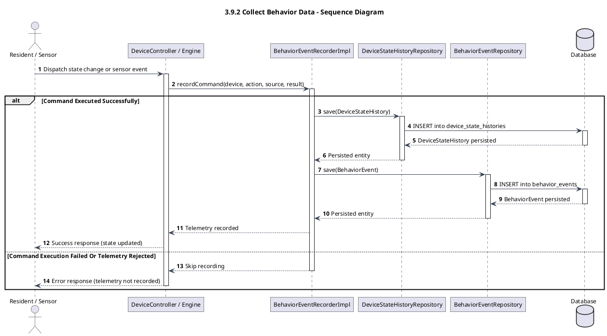
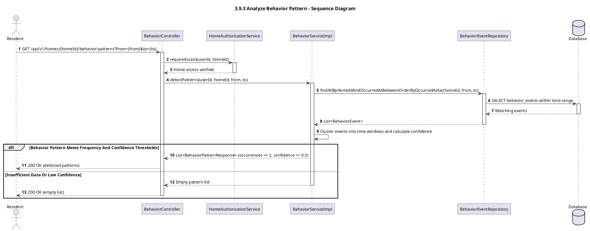
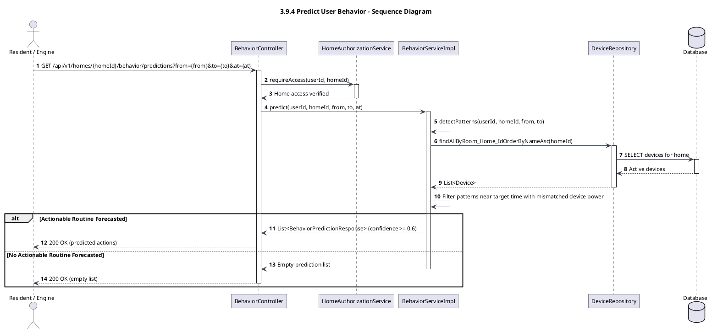
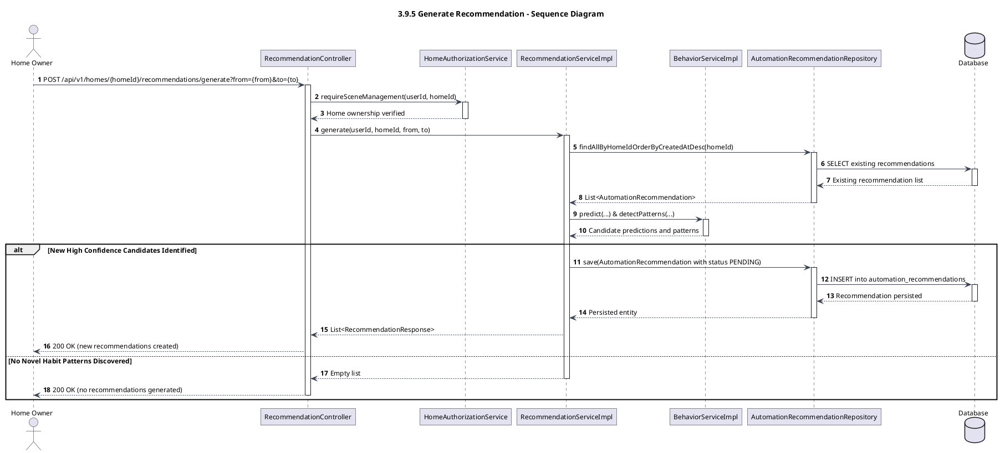
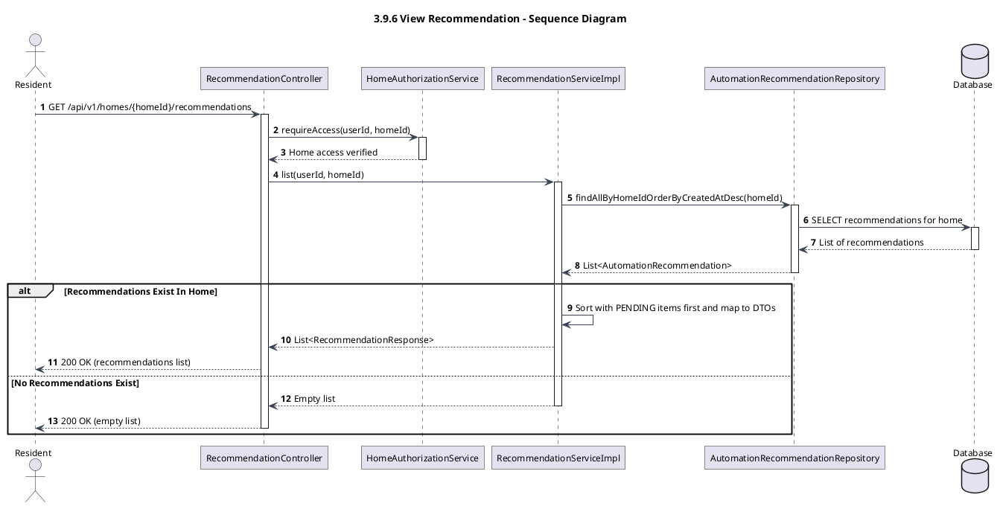
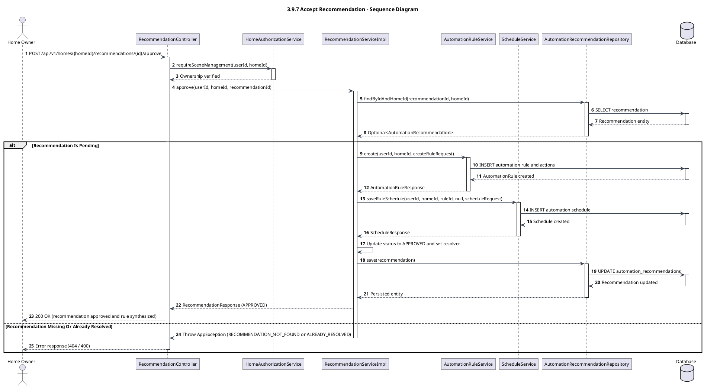
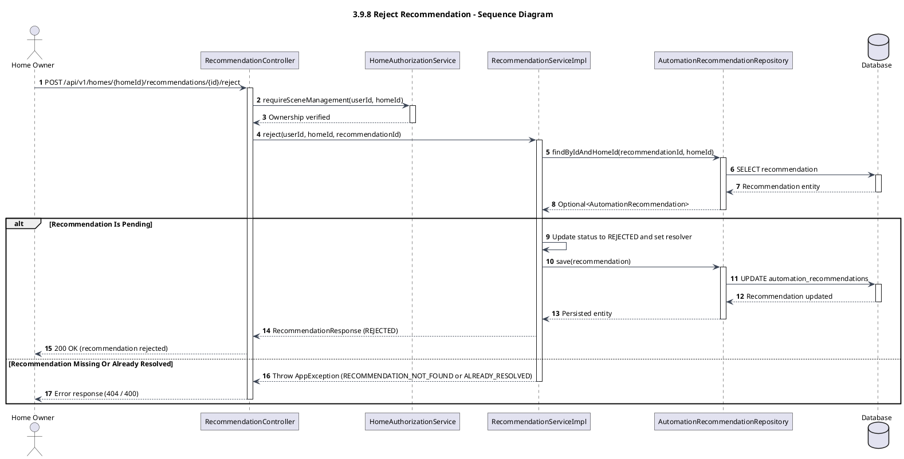
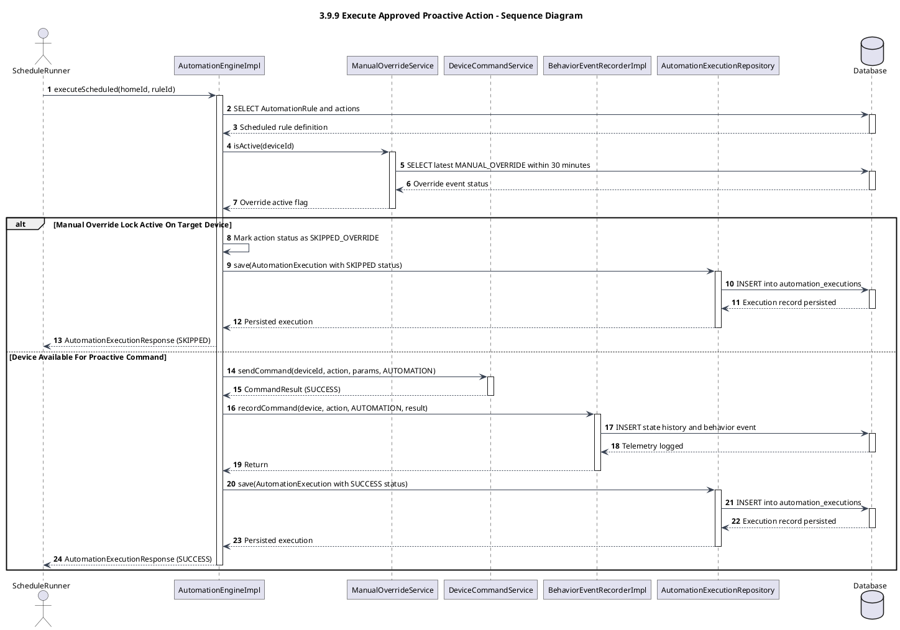
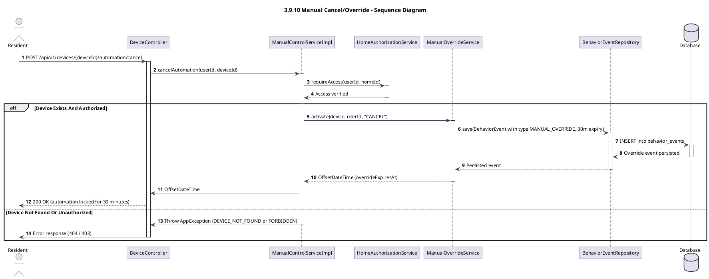

# 3.9 Analyze User Behavior

> Technical specification and architectural modeling for **3.9 Analyze User Behavior** in the HESTA Smart Home system.
>
> All models and diagrams strictly correspond to the production codebase:
> - Controllers: [`BehaviorController.java`](file:///d:/CapstoneProject/backend_hesta/src/main/java/com/hesta/backend/controller/BehaviorController.java), [`RecommendationController.java`](file:///d:/CapstoneProject/backend_hesta/src/main/java/com/hesta/backend/controller/RecommendationController.java), [`DeviceController.java`](file:///d:/CapstoneProject/backend_hesta/src/main/java/com/hesta/backend/controller/DeviceController.java)
> - Services: [`BehaviorServiceImpl.java`](file:///d:/CapstoneProject/backend_hesta/src/main/java/com/hesta/backend/service/impl/BehaviorServiceImpl.java), [`RecommendationServiceImpl.java`](file:///d:/CapstoneProject/backend_hesta/src/main/java/com/hesta/backend/service/impl/RecommendationServiceImpl.java), [`BehaviorEventRecorderImpl.java`](file:///d:/CapstoneProject/backend_hesta/src/main/java/com/hesta/backend/service/impl/BehaviorEventRecorderImpl.java), [`ManualControlServiceImpl.java`](file:///d:/CapstoneProject/backend_hesta/src/main/java/com/hesta/backend/service/impl/ManualControlServiceImpl.java), [`ManualOverrideServiceImpl.java`](file:///d:/CapstoneProject/backend_hesta/src/main/java/com/hesta/backend/service/impl/ManualOverrideServiceImpl.java)
> - Domain Entities: [`BehaviorEvent.java`](file:///d:/CapstoneProject/backend_hesta/src/main/java/com/hesta/backend/entity/BehaviorEvent.java), [`BehaviorPattern.java`](file:///d:/CapstoneProject/backend_hesta/src/main/java/com/hesta/backend/entity/BehaviorPattern.java), [`AutomationRecommendation.java`](file:///d:/CapstoneProject/backend_hesta/src/main/java/com/hesta/backend/entity/AutomationRecommendation.java), [`DeviceStateHistory.java`](file:///d:/CapstoneProject/backend_hesta/src/main/java/com/hesta/backend/entity/DeviceStateHistory.java)
> - Repositories: [`BehaviorEventRepository.java`](file:///d:/CapstoneProject/backend_hesta/src/main/java/com/hesta/backend/repository/BehaviorEventRepository.java), [`AutomationRecommendationRepository.java`](file:///d:/CapstoneProject/backend_hesta/src/main/java/com/hesta/backend/repository/AutomationRecommendationRepository.java), [`DeviceStateHistoryRepository.java`](file:///d:/CapstoneProject/backend_hesta/src/main/java/com/hesta/backend/repository/DeviceStateHistoryRepository.java), [`DeviceRepository.java`](file:///d:/CapstoneProject/backend_hesta/src/main/java/com/hesta/backend/repository/DeviceRepository.java), [`UserRepository.java`](file:///d:/CapstoneProject/backend_hesta/src/main/java/com/hesta/backend/repository/UserRepository.java)

---

## Module Overview

The **User Behavior Analysis & Proactive Recommendation** subsystem enables intelligent adaptation to household routines:
1. **Behavior Data Telemetry Collection**: Intercepts device interactions from multiple sources (`MANUAL` resident switch/app actions, `SENSOR` environmental telemetry, `SCHEDULE` dispatches, and `AUTOMATION` executions) to build an audit trail of [`BehaviorEvent`](file:///d:/CapstoneProject/backend_hesta/src/main/java/com/hesta/backend/entity/BehaviorEvent.java) and [`DeviceStateHistory`](file:///d:/CapstoneProject/backend_hesta/src/main/java/com/hesta/backend/entity/DeviceStateHistory.java).
2. **Behavior Pattern Detection**: Analyzes historical behavior logs over flexible time frames, clustering recurring device actions into diurnal time windows (`MORNING` 05:00–10:00, `BEDTIME` 20:00–24:00) with confidence thresholds based on repeat day frequency.
3. **Behavior Prediction**: Forecasts impending device actions within a 45-minute window of the current time based on observed habits where device power states have not yet converged.
4. **Automation Recommendation Lifecycle**: Generates high-confidence [`AutomationRecommendation`](file:///d:/CapstoneProject/backend_hesta/src/main/java/com/hesta/backend/entity/AutomationRecommendation.java) items in `PENDING` state. Home Owners can review explanations and choose to approve (`APPROVED`) or dismiss (`REJECTED`).
5. **Seamless Proactive Synthesis**: Approving a recommendation automatically creates a concrete [`AutomationRule`](file:///d:/CapstoneProject/backend_hesta/src/main/java/com/hesta/backend/entity/AutomationRule.java) and corresponding time schedule ([`ScheduleService`](file:///d:/CapstoneProject/backend_hesta/src/main/java/com/hesta/backend/service/ScheduleService.java)), promoting habit analysis into active automation.
6. **Execution & Manual Override Guard**: Proactive actions dispatch via [`AutomationEngine`](file:///d:/CapstoneProject/backend_hesta/src/main/java/com/hesta/backend/service/AutomationEngine.java) and [`DeviceCommandService`](file:///d:/CapstoneProject/backend_hesta/src/main/java/com/hesta/backend/service/DeviceCommandService.java). If a resident executes a manual override or explicit automation cancellation, [`ManualOverrideService`](file:///d:/CapstoneProject/backend_hesta/src/main/java/com/hesta/backend/service/ManualOverrideService.java) enforces a 30-minute safety lockout (`SKIPPED_OVERRIDE`), preserving resident autonomy over automated predictions.

---

## 3.9.1 Class diagram

The class diagram below depicts the architectural structure of the User Behavior Analysis subsystem organized into four cohesive layers:
- **Controller & Service Layer**: REST controllers, business services, and event recording collaborators.
- **Persistence Layer**: Spring Data JPA repositories interfacing with the underlying database.
- **Domain Model Layer**: Core entities representing events, patterns, recommendations, and hardware state history.
- **DTO Layer**: Strongly typed request/response transfer contracts.

```plantuml
@startuml C_3_9_User_Behavior
title 3.9.1 Analyze User Behavior - Class Diagram
skinparam backgroundColor white
skinparam shadowing false
skinparam roundcorner 0
skinparam defaultFontName Arial
skinparam defaultFontSize 12
skinparam ArrowColor #374151
hide circle
skinparam classAttributeIconSize 0
skinparam nodesep 30
skinparam ranksep 40

package "Controller & Service Layer" as ServiceLayer {
  class BehaviorController {
    - behaviorService : BehaviorService
    + generate(user, homeId, request) : ResponseEntity<ApiResponse<BehaviorDatasetResponse>>
    + patterns(user, homeId, from, to) : ResponseEntity<ApiResponse<List<BehaviorPatternResponse>>>
    + predictions(user, homeId, from, to, at) : ResponseEntity<ApiResponse<List<BehaviorPredictionResponse>>>
  }

  class RecommendationController {
    - recommendations : RecommendationService
    + list(user, homeId) : ResponseEntity<ApiResponse<List<RecommendationResponse>>>
    + generate(user, homeId, from, to) : ResponseEntity<ApiResponse<List<RecommendationResponse>>>
    + approve(user, homeId, recommendationId) : ResponseEntity<ApiResponse<RecommendationResponse>>
    + reject(user, homeId, recommendationId) : ResponseEntity<ApiResponse<RecommendationResponse>>
  }

  class DeviceController {
    - manualControlService : ManualControlService
    + command(userDetails, deviceId, request) : ResponseEntity<ApiResponse<ManualCommandResponse>>
    + cancelAutomation(userDetails, deviceId) : ResponseEntity<ApiResponse<OffsetDateTime>>
    + overrideHistory(userDetails, deviceId) : ResponseEntity<ApiResponse<List<ManualOverrideResponse>>>
  }

  interface BehaviorService {
    + generate(userId, homeId, request) : BehaviorDatasetResponse
    + detectPatterns(userId, homeId, from, to) : List<BehaviorPatternResponse>
    + predict(userId, homeId, from, to, at) : List<BehaviorPredictionResponse>
  }

  class BehaviorServiceImpl {
    - homeAuthorizationService : HomeAuthorizationService
    - deviceRepository : DeviceRepository
    - userRepository : UserRepository
    - eventRepository : BehaviorEventRepository
    + generate(userId, homeId, request) : BehaviorDatasetResponse
    + detectPatterns(userId, homeId, from, to) : List<BehaviorPatternResponse>
    + predict(userId, homeId, from, to, at) : List<BehaviorPredictionResponse>
    - window(time) : String
    - pattern(key, events, totalDays) : BehaviorPatternResponse
  }

  interface RecommendationService {
    + generate(userId, homeId, from, to) : List<RecommendationResponse>
    + list(userId, homeId) : List<RecommendationResponse>
    + approve(userId, homeId, recommendationId) : RecommendationResponse
    + reject(userId, homeId, recommendationId) : RecommendationResponse
  }

  class RecommendationServiceImpl {
    - authorization : HomeAuthorizationService
    - behavior : BehaviorService
    - recommendations : AutomationRecommendationRepository
    - devices : DeviceRepository
    - users : UserRepository
    - rules : AutomationRuleService
    - schedules : ScheduleService
    + generate(userId, homeId, from, to) : List<RecommendationResponse>
    + list(userId, homeId) : List<RecommendationResponse>
    + approve(userId, homeId, recommendationId) : RecommendationResponse
    + reject(userId, homeId, recommendationId) : RecommendationResponse
    - duplicate(existing, deviceId, action, time) : boolean
  }

  interface BehaviorEventRecorder {
    + recordCommand(device, action, source, result) : void
    + recordSensor(device, event) : void
    + recordExecution(home, userId, eventType, targetId, status) : void
  }

  class BehaviorEventRecorderImpl {
    - behaviorEvents : BehaviorEventRepository
    - deviceHistory : DeviceStateHistoryRepository
    - devices : DeviceRepository
    - users : UserRepository
    + recordCommand(device, action, source, result) : void
    + recordSensor(device, event) : void
    + recordExecution(home, userId, eventType, targetId, status) : void
  }

  interface ManualControlService {
    + command(userId, deviceId, rawAction) : ManualCommandResponse
    + cancelAutomation(userId, deviceId) : OffsetDateTime
    + history(userId, deviceId) : List<ManualOverrideResponse>
  }

  class ManualControlServiceImpl {
    - authorization : HomeAuthorizationService
    - devices : DeviceRepository
    - commands : DeviceCommandService
    - overrides : ManualOverrideService
    - recorder : BehaviorEventRecorder
    - behaviorEvents : BehaviorEventRepository
    + command(userId, deviceId, rawAction) : ManualCommandResponse
    + cancelAutomation(userId, deviceId) : OffsetDateTime
    + history(userId, deviceId) : List<ManualOverrideResponse>
  }

  interface ManualOverrideService {
    + activate(device, userId, reason) : OffsetDateTime
    + isActive(deviceId) : boolean
  }

  class ManualOverrideServiceImpl {
    - events : BehaviorEventRepository
    - users : UserRepository
    + activate(device, userId, reason) : OffsetDateTime
    + isActive(deviceId) : boolean
  }

  class HomeAuthorizationService {
    + requireAccess(userId, homeId) : Home
    + requireSceneManagement(userId, homeId) : Home
  }
}

package "Persistence Layer" as PersistenceLayer {
  interface BehaviorEventRepository <<repository>> {
    + findAllByHomeIdAndOccurredAtBetweenOrderByOccurredAtAsc(homeId, from, to) : List<BehaviorEvent>
    + findTopByDeviceIdAndEventTypeOrderByOccurredAtDesc(deviceId, eventType) : Optional<BehaviorEvent>
    + findTop100ByDeviceIdAndEventTypeOrderByOccurredAtDesc(deviceId, eventType) : List<BehaviorEvent>
    + deleteGeneratedDataset(homeId, datasetKey) : void
    + save(entity) : BehaviorEvent
    + saveAll(entities) : List<BehaviorEvent>
  }

  interface AutomationRecommendationRepository <<repository>> {
    + findAllByHomeIdOrderByCreatedAtDesc(homeId) : List<AutomationRecommendation>
    + findByIdAndHomeId(id, homeId) : Optional<AutomationRecommendation>
    + save(entity) : AutomationRecommendation
  }

  interface DeviceStateHistoryRepository <<repository>> {
    + save(entity) : DeviceStateHistory
  }

  interface DeviceRepository <<repository>> {
    + findAllByRoom_Home_IdOrderByNameAsc(homeId) : List<Device>
    + findById(id) : Optional<Device>
    + save(entity) : Device
  }

  interface UserRepository <<repository>> {
    + findById(id) : Optional<User>
  }
}

package "Domain Model Layer" as DomainLayer {
  class BehaviorEvent {
    - id : UUID
    - home : Home
    - user : User
    - room : Room
    - device : Device
    - eventType : String
    - action : String
    - previousState : Map<String, Object>
    - currentState : Map<String, Object>
    - eventSource : String
    - datasetKey : String
    - occurredAt : OffsetDateTime
  }

  class BehaviorPattern {
    - id : UUID
    - home : Home
    - device : Device
    - patternType : String
    - triggerCondition : Map<String, Object>
    - suggestedAction : Map<String, Object>
    - confidenceScore : BigDecimal
    - occurrences : Integer
    - lastDetectedAt : OffsetDateTime
  }

  class AutomationRecommendation {
    - id : UUID
    - home : Home
    - device : Device
    - triggerCondition : Map<String, Object>
    - proposedAction : Map<String, Object>
    - explanation : String
    - confidenceScore : BigDecimal
    - status : String
    - createdAt : OffsetDateTime
    - resolvedAt : OffsetDateTime
    - resolvedBy : User
  }

  class DeviceStateHistory {
    - id : UUID
    - device : Device
    - previousState : Map<String, Object>
    - newState : Map<String, Object>
    - source : StateChangeSource
    - changedBy : User
    - isTest : Boolean
    - changedAt : OffsetDateTime
  }
}

package "DTO Contracts" as DtoLayer {
  class BehaviorPatternResponse {
    - patternType : String
    - deviceId : UUID
    - deviceName : String
    - roomId : UUID
    - roomName : String
    - action : String
    - averageTime : LocalTime
    - occurrences : Integer
    - confidence : Double
  }

  class BehaviorPredictionResponse {
    - deviceId : UUID
    - deviceName : String
    - action : String
    - predictedTime : LocalTime
    - confidence : Double
    - reason : String
  }

  class RecommendationResponse {
    - id : UUID
    - homeId : UUID
    - deviceId : UUID
    - deviceName : String
    - triggerCondition : Map<String, Object>
    - proposedAction : Map<String, Object>
    - explanation : String
    - confidence : Double
    - status : String
    - createdAt : OffsetDateTime
    - resolvedAt : OffsetDateTime
  }

  class ManualOverrideResponse {
    - id : UUID
    - action : String
    - userId : UUID
    - occurredAt : OffsetDateTime
    - expiresAt : OffsetDateTime
  }
}

BehaviorController ..> BehaviorService : uses
RecommendationController ..> RecommendationService : uses
DeviceController ..> ManualControlService : uses

BehaviorServiceImpl ..|> BehaviorService : implements
BehaviorServiceImpl ..> HomeAuthorizationService : verifies
BehaviorServiceImpl ..> BehaviorEventRepository : accesses
BehaviorServiceImpl ..> DeviceRepository : accesses

RecommendationServiceImpl ..|> RecommendationService : implements
RecommendationServiceImpl ..> HomeAuthorizationService : verifies
RecommendationServiceImpl ..> BehaviorService : delegates
RecommendationServiceImpl ..> AutomationRecommendationRepository : manages
RecommendationServiceImpl ..> DeviceRepository : accesses

BehaviorEventRecorderImpl ..|> BehaviorEventRecorder : implements
BehaviorEventRecorderImpl ..> BehaviorEventRepository : records
BehaviorEventRecorderImpl ..> DeviceStateHistoryRepository : audits

ManualControlServiceImpl ..|> ManualControlService : implements
ManualControlServiceImpl ..> ManualOverrideService : activates
ManualControlServiceImpl ..> BehaviorEventRecorder : triggers

ManualOverrideServiceImpl ..|> ManualOverrideService : implements
ManualOverrideServiceImpl ..> BehaviorEventRepository : stores

BehaviorEventRepository ..> BehaviorEvent : persists
AutomationRecommendationRepository ..> AutomationRecommendation : persists
DeviceStateHistoryRepository ..> DeviceStateHistory : persists
@enduml
```

---

## 3.9.2 Collect Behavior Data

This sequence diagram depicts behavior data collection. When physical sensors report telemetry or residents execute manual control commands, the system intercepts the event, evaluates the outcome, and writes audit records to [`DeviceStateHistory`](file:///d:/CapstoneProject/backend_hesta/src/main/java/com/hesta/backend/entity/DeviceStateHistory.java) and [`BehaviorEvent`](file:///d:/CapstoneProject/backend_hesta/src/main/java/com/hesta/backend/entity/BehaviorEvent.java).

---

## 3.9.3 Analyze Behavior Pattern

This sequence diagram illustrates behavior pattern detection. The resident requests pattern discovery over a designated time range. [`BehaviorServiceImpl`](file:///d:/CapstoneProject/backend_hesta/src/main/java/com/hesta/backend/service/impl/BehaviorServiceImpl.java) groups logged events into diurnal time windows (`MORNING` or `BEDTIME`), evaluates occurrence consistency across days, and filters candidates using confidence thresholds.

---

## 3.9.4 Predict User Behavior

This sequence diagram depicts behavior prediction forecasting. [`BehaviorServiceImpl`](file:///d:/CapstoneProject/backend_hesta/src/main/java/com/hesta/backend/service/impl/BehaviorServiceImpl.java) inspects detected patterns, evaluates temporal proximity against target timestamp `at` (within a 45-minute window), checks whether target devices already reflect the expected state, and returns impending routine actions.

---

## 3.9.5 Generate Recommendation

This sequence diagram depicts the recommendation generation flow. [`RecommendationServiceImpl`](file:///d:/CapstoneProject/backend_hesta/src/main/java/com/hesta/backend/service/impl/RecommendationServiceImpl.java) synthesizes predictive forecasts and detected habit patterns, checks for duplicates, and creates pending [`AutomationRecommendation`](file:///d:/CapstoneProject/backend_hesta/src/main/java/com/hesta/backend/entity/AutomationRecommendation.java) entities.

---

## 3.9.6 View Recommendation

This sequence diagram depicts retrieving recommendations for a home. Residents view active proposals to understand system explanations and confidence scores.

---

## 3.9.7 Accept Recommendation

This sequence diagram illustrates accepting a recommendation. Upon owner approval, [`RecommendationServiceImpl`](file:///d:/CapstoneProject/backend_hesta/src/main/java/com/hesta/backend/service/impl/RecommendationServiceImpl.java) marks the recommendation `APPROVED` and automatically creates an [`AutomationRule`](file:///d:/CapstoneProject/backend_hesta/src/main/java/com/hesta/backend/entity/AutomationRule.java) and an associated time schedule.

---

## 3.9.8 Reject Recommendation

This sequence diagram depicts rejecting a recommendation. An owner dismisses an unwanted proposal, transitioning its status to `REJECTED` and archiving it.

---

## 3.9.9 Execute Approved Proactive Action

This sequence diagram depicts runtime execution of an approved proactive rule. At the scheduled time, the [`AutomationEngine`](file:///d:/CapstoneProject/backend_hesta/src/main/java/com/hesta/backend/service/AutomationEngine.java) loads the rule, checks for active manual overrides on the target hardware, and either dispatches the command or skips execution if a resident recently intervened.

---

## 3.9.10 Manual Cancel/Override

This sequence diagram depicts manual cancel/override. When a resident directly switches a device or presses "Cancel Automation" in the UI, [`ManualControlServiceImpl`](file:///d:/CapstoneProject/backend_hesta/src/main/java/com/hesta/backend/service/impl/ManualControlServiceImpl.java) records a `MANUAL_OVERRIDE` event, establishing a 30-minute safety lockout that prevents automated proactive commands from superseding resident intent.

